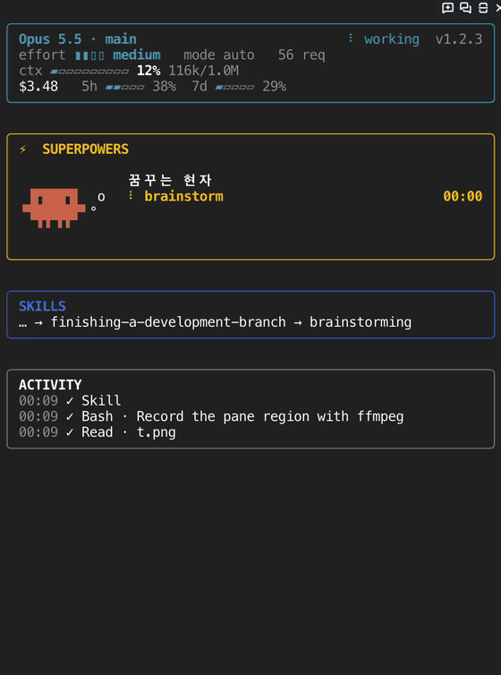
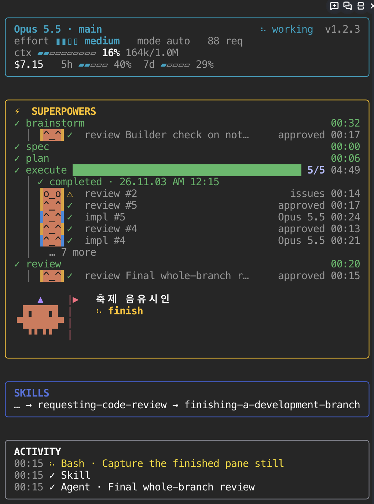

# bob-progress

Claude Code mod: a pane docked to the right of the transcript that monitors any session, with a separate section for the superpowers workflow. Sections with nothing to show stay hidden.

Since 1.0 the hooks only turn what happens into events; one pure reducer (`hooks/state.ts`) folds them into a single state, and the pane renders that state.
The same reducer replays recorded sessions (see [Local replay](#local-replay)).

1. **main** — model, working/idle, effort, permission mode, request count, context gauge (⟲ compactions), cost and rate limits, and a dim `v1.2.0` at the right of the first line (layout from [Flightdeck](https://github.com/scasella/claude-flightdeck), MIT)
2. **⚡ SUPERPOWERS** — shows once a superpowers skill runs (or a superpowers plan is opened):
   - how big the work is (superpowers 7.0.1): `SMALL` for "a small change" / "작은 변경", `PROJECT` for "a project", `SPIKE` for a spike; it only steps up (6.4.1's `bounded` / `architectural` show as `SMALL` / `PROJECT`)
   - the current stage is drawn as a card of its Clawd at work (sage · scribe · archmage architect · druid · blacksmith · shadow tracker · bard: 꿈꾸는 현자 · 필경사 · 대마법 건축가 · 숲의 드루이드 · 망치 대장장이 · 그림자 추적자 · 축제 음유시인, in bold), and each agent as a robot bit in its role's colour (`[•_•]⚙` working, `[^_^]✓` done, `[x_x]✗` failed, `[o_o]⚠` issues, `[-_-]z` waiting); they move only while working. On desktop they are pixel sprites animated with CSS, each agent a little Clawd in its role's colour hat with its face showing the status, and the plan bar is drawn to fit the row; sections and stages are spaced apart there; in panes narrower than 40 columns the card falls back to the plain row
   - a timeline, one row per stage with how long it took: `✓ brainstorm 04:10`, `⠹ execute ███▓▓░░ 3/7 05:02`, `○ review`. Small changes and projects (or any cycle that wrote a spec or plan) show every stage ahead; `worktree` joins once reached; `finish` and stages reached out of order show no time
   - on the execute row, the plan's progress bar (`docs/superpowers/plans/*.md`, `### Task N:` headings, completed by the SDD ledger — `Task N: complete`, list items too — or ticked steps); below it the current task (the ledger's `Task N: dispatched` one, or when executing-plans runs it inline, the one `task-start` last took), a highlight sweeping across it while it works and its running agent's phase on the right: `⠹ #4 Add verdict parser   review 00:41` (`impl`, `review`, `fix`, `re-review`), or when it all finished. A main-loop edit during execute that no task claims (no dispatch, no `task-start`, no listed file) gets a one-time note back to Claude asking it to `task-start` or ledger `Task N: dispatched` first; it never blocks the edit
   - under each stage, the agents that ran in it by role, working ones first, then ones with issues, then the latest, 5 at most and `… N more`: `[•_•]⚙ impl #4  Haiku 5.5 01:12`, `[^_^]✓ review #3  approved 00:41` (`[o_o]⚠ … issues` when the review wants fixes); fix agents count as impl, brainstorming's builder check as a review
   - the stage only moves forward: review waits until every plan task is done, and a skill a subagent loads never moves it
   - extras used along the way: `+ tdd  + debugging  + verification`
3. **TASKS** — todos (TodoWrite / TaskCreate), else a plan-mode plan (`~/.claude/plans/*.md`, its `- [ ]` checkboxes, else its numbered steps ticked as `1. [x]`): progress bar with `done/total · %` beside it, in-progress tasks in yellow, the current step below with its number (`▸ #2 Wiring`), or the next one (`○ 다음: …`) when none has started, and `✓ completed · 26.10.09 PM 02:05` once every task is done
4. **AGENTS** — every other subagent as `[•_•]» 1: Explore auth --- Haiku 5.5 01:23`, running ones first (`[-_-]z` when waiting on its own background work), then the latest 3 that ended (`[^_^]✓` done, `[x_x]✗` failed) with their final time. The header counts all agents: `2 running · 5 done · 1 failed`
5. **SKILLS** — every skill run, in order: `brainstorming → writing-plans → subagent-driven-development`
6. **ACTIVITY** — the main loop's latest 3 tool calls: `14:05 ⠹ Bash · Run tests`, `✓` once done, `✗` on error

While Claude or an agent works, spinners turn and a bright cell sweeps the in-progress part of each progress bar.

The demo records only the pane while a mock superpowers cycle runs in the same session (a notification-settings page: brainstorm with a builder check → spec → plan → 5 plan tasks, one impl subagent each plus task reviews, one review asking for fixes `[o_o]⚠` and a fix agent; a whole-branch review; then finish), sped up 5×:





The pane opens on session start. `/bob-progress` reopens it, `/bob-progress close` closes it. In a non-fullscreen terminal it sits inline above the prompt instead.

## Install

```
/plugin install bob-progress --marketplace bob-park/bob-progress
```

Answer `y` to add the marketplace, then pick a scope.

## Local replay

```
bun test replay
```

Replays every local session that ran `superpowers:executing-plans` or `superpowers:subagent-driven-development` (under `~/.claude/projects`, or `REPLAY_DIR`) through the reducer and checks that no edit slips past the current task unwarned, that completed counts and stages never move back, and that each plan ends with the tasks its ledger or ticks prove done. It prints each session's file name with the share of execute edits tied to a task, and lists sessions it skips. Nothing from the transcripts (commands, paths, text) is printed or stored. With no sessions it skips; `claude plugin test .` runs the unit tests only.
